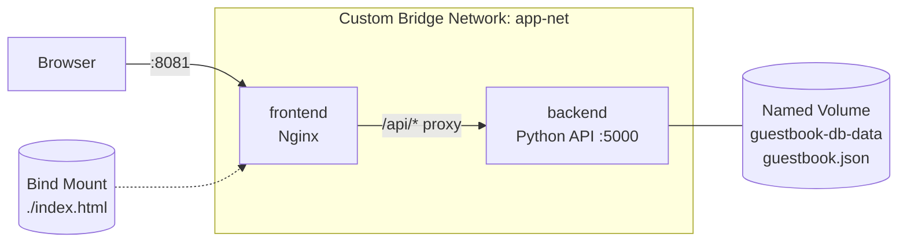
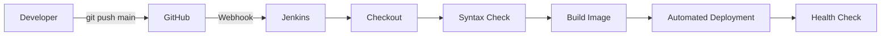

# Buku Tamu Digital Kampus (Digital Guestbook)

Tugas Kelompok UTS Cloud Computing, Telkom University
**Cloud-Native Fullstack Application & Automated CI/CD Pipeline**

## Anggota Kelompok

| No | Nama | NIM |
|----|------|-----|
| 1  | Dariele Zebada Sanuwu Gea | 101012300089 |
| 2  | Sattya Haa Prabu Tejo Putri | 101012330223 |
| 3  | Rachel Triyana Br Situmorang | 101012330401 |

**Studi kasus:** #1 Buku Tamu Digital Kampus (Digital Guestbook)

**Video demo:** _tempel tautan video di sini_

## Deskripsi

Aplikasi pencatat daftar tamu acara kampus. Pengguna dapat melihat daftar tamu, menambahkan tamu baru, dan menghapus entri tamu. Seluruh aplikasi dijalankan dengan Docker Compose dan di-deploy otomatis oleh Jenkins setiap ada `git push` ke branch `main`.

## Teknologi

- **Backend:** Python (`http.server`, tanpa framework), REST API JSON
- **Frontend:** HTML + Vanilla JS (`fetch()`), disajikan oleh Nginx
- **Infrastruktur:** Docker, Named Volume, Bind Mount, Custom Bridge Network, Docker Compose
- **CI/CD:** Jenkins (Declarative Pipeline) + GitHub Webhook

## Arsitektur





| Komponen | Detail |
|----------|--------|
| Backend | Image dibangun dari `Dockerfile`, container `guestbook-backend`, port 5000 |
| Frontend | `nginx:alpine`, container `guestbook-frontend`, host port 8081 |
| Network | `app-net` (bridge), antar-kontainer memakai nama service (`backend`) |
| Named Volume | `guestbook-db-data` dipasang ke `/var/lib/backend_data` (menyimpan `guestbook.json`) |
| Bind Mount | `./index.html` dan `./nginx.conf` dipasang ke Nginx |

## Struktur Repository

```
.
├── app.py               # Backend REST API
├── index.html           # Frontend
├── Dockerfile           # Image backend
├── docker-compose.yml   # Definisi stack
├── nginx.conf           # Konfigurasi Nginx (serve + proxy /api)
├── Jenkinsfile          # Pipeline CI/CD
├── .gitignore
└── README.md
```

## API

| Method | Endpoint | Keterangan |
|--------|----------|------------|
| GET | `/health` | Status layanan |
| GET | `/messages` | Daftar tamu |
| POST | `/messages` | Tambah tamu. Body: `{"name": "...", "message": "..."}` |
| DELETE | `/messages?index=X` | Hapus tamu berdasarkan index |

Kode error: `400` (input tidak valid), `404` (endpoint/data tidak ditemukan), `500` (gagal baca/tulis data).

Contoh:

```bash
curl http://localhost:5000/messages
curl -X POST http://localhost:5000/messages \
  -H "Content-Type: application/json" \
  -d '{"name":"Budi","message":"Acara yang bagus!"}'
curl -X DELETE "http://localhost:5000/messages?index=0"
```

## Instalasi Lokal

Prasyarat: Docker dan Docker Compose v2, Git.

```bash
git clone https://github.com/DrealGea/cloud-computing-midterm-project.git
cd cloud-computing-midterm-project
docker compose up -d --build
```

Buka **http://localhost:8081** untuk UI. API langsung tersedia di **http://localhost:5000**.

Perintah berguna:

```bash
docker compose ps                 # status kontainer
docker compose logs -f            # lihat log
docker compose down               # hentikan (data TETAP aman)
```

> Jangan memakai `docker compose down -v` kecuali ingin menghapus data tamu.

## Pembuktian Data Immunity (Named Volume)

```bash
# 1. Tambahkan beberapa tamu lewat UI / curl
# 2. Hapus paksa kontainer backend
docker rm -f guestbook-backend
# 3. Buat ulang
docker compose up -d
# 4. Buka UI: data tamu masih ada
```

## Pembuktian Bind Mount

Ubah teks pada `index.html` (misalnya judul), simpan, lalu refresh browser. Perubahan langsung terlihat tanpa `docker build`.

## Setup Jenkins & CI/CD

### 1. Prasyarat Jenkins
- Jenkins berjalan dan dapat menjalankan perintah `docker` serta `docker compose` (user `jenkins` masuk grup `docker`).
- `python3` dan `curl` terpasang di mesin Jenkins.
- Plugin: Git, GitHub, Pipeline.

### 2. Buat GitHub Personal Access Token (PAT)
GitHub → Settings → Developer settings → Personal access tokens → Tokens (classic) → Generate new token (classic).
Centang `repo` dan `admin:repo_hook`, lalu salin token (`ghp_...`).

### 3. Tambahkan Credentials di Jenkins
Manage Jenkins → Credentials → Global → Add Credentials:
- Kind: **Username with password**
- Username: username GitHub
- Password: PAT
- ID: `github-pat`

### 4. Buat Pipeline Job
- New Item → **Pipeline**
- Build Triggers: centang **GitHub hook trigger for GITScm polling**
- Pipeline → Definition: **Pipeline script from SCM**
  - SCM: Git
  - Repository URL: `https://github.com/DrealGea/cloud-computing-midterm-project.git`
  - Credentials: `github-pat`
  - Branch Specifier: `*/main`
  - Script Path: `Jenkinsfile`
- Jalankan **Build Now** sekali untuk uji awal.

### 5. Pasang GitHub Webhook
Jenkins harus dapat dijangkau dari internet (jika Jenkins lokal, gunakan tunnel seperti ngrok atau cloudflared).

Repo GitHub → Settings → Webhooks → Add webhook:
- Payload URL: `https://<alamat-jenkins>/github-webhook/` (garis miring di akhir wajib ada)
- Content type: `application/json`
- Event: **Just the push event**

### 6. Uji Auto-Deploy
```bash
git add .
git commit -m "Uji webhook"
git push origin main
```
Jenkins akan terpicu otomatis dan menjalankan 5 stage:

| Stage | Fungsi |
|-------|--------|
| Checkout | Mengambil kode terbaru dari GitHub |
| Syntax Check | `py_compile app.py` dan validasi `docker-compose.yml` |
| Build Image | Build image backend |
| Automated Deployment | `docker compose up -d --force-recreate` |
| Health Check | Memeriksa `/health` backend dan lewat proxy Nginx |

## Troubleshooting

| Masalah | Solusi |
|---------|--------|
| Port 8081 / 5000 sudah dipakai | Ubah mapping port di `docker-compose.yml` (frontend harus tetap di port 80 atau 8081 agar `index.html` memakai `/api`) |
| `permission denied` docker di Jenkins | `sudo usermod -aG docker jenkins` lalu restart Jenkins |
| Webhook tidak memicu build | Cek Recent Deliveries di GitHub, pastikan URL berakhiran `/github-webhook/` |
| UI menampilkan "Gagal memuat data" | Cek `docker compose logs backend` dan pastikan akses lewat `http://localhost:8081` |
